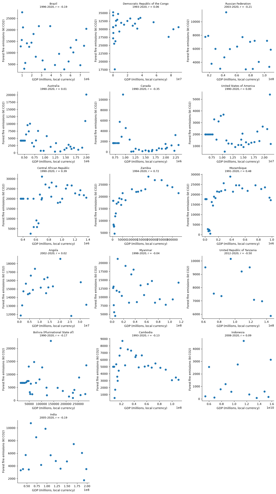

# tdd

Combines the Agrofood CO2 emission and IMF
GDP data sets by country and year, then plots forest fire emissions
against GDP for 16 countries. Written with test driven development; the
analysis runs as a [Snakemake](https://snakemake.readthedocs.io) workflow.

## Installation

```
git clone <your fork of this repo>
cd tdd
mamba env create -f environment.yml
mamba activate swe4s
```

If you already have the `swe4s` environment, add Snakemake with
`mamba env update -f environment.yml`.

## Usage

### Workflow

The `Snakefile` downloads the data and makes every plot:

```
snakemake --cores 1
```

| Rule | Makes |
| --- | --- |
| `get_inputs` | `data/{dataset}.csv`, downloaded with `curl` (not tracked by git) |
| `plot_country` | `doc/countries/{country}.png`, one plot per country |
| `plot_all_countries` | `doc/fire_gdp.png`, all countries in one figure |
| `all` | everything above (the default target) |

The countries are set in the `COUNTRIES` variable at the top of the
`Snakefile`. Each key is the `{country}` wildcard used in file names, and each
value is the country name as written in both data files. Add a country there
to add it to every plot. To make a single target, name it:

```
snakemake --cores 1 doc/countries/Zambia.png
```

Add `-n` to see what would run without running it. Snakemake only reruns a
step when its output is missing or older than its inputs (including
`src/plot_fire_gdp.py` and `src/fire_gdp.py`). After changing `COUNTRIES`, run
`snakemake --cores 1 --forcerun plot_all_countries` so the combined figure is
remade.

### Scripts

`src/fire_gdp.py` is a library:

- `get_data(file_name, query_column=None, query_value=None, return_header=False)`
  returns the rows of a CSV file, optionally only those where column
  `query_column` equals `query_value`, and optionally the header.
- `get_column_index(header, column_name)` returns the position of
  `column_name` in `header`, or `None` if it is absent.
- `get_fire_gdp_year_data(co2_file, gdp_file, country)` returns
  `[year, forest_fires, gdp]` for every year with both values present.

```
>>> import fire_gdp
>>> fire_gdp.get_fire_gdp_year_data('data/Agrofood_co2_emission.csv',
...                                 'data/IMF_GDP.csv', 'Brazil')[9]
[2005, 18253.5232, 2170584.5]
```

`src/plot_fire_gdp.py` makes one scatter plot per country:

```
usage: plot_fire_gdp.py [-h] [--co2_file CO2_FILE] [--gdp_file GDP_FILE]
                        [--countries COUNTRIES [COUNTRIES ...]] --out OUT
```

- `--co2_file` defaults to `data/Agrofood_co2_emission.csv`
- `--gdp_file` defaults to `data/IMF_GDP.csv`
- `--countries` defaults to the six countries below; names must match both
  files exactly (e.g. `"United States of America"`)
- `--out` is the output image (required)

Countries with fewer than two matching years are skipped with a message. A
missing input file exits with code 1.

```
python src/plot_fire_gdp.py --countries Brazil Canada --out brazil_canada.png
```

## Testing

```
python test/unit/test_fire_gdp.py
bash test/func/test_fire_gdp.sh
```

Tests use the small files in `test/data`. These test the Python code, not
the workflow. See below for ways the workflow could be tested.

### Ideas for testing the workflow

The workflow is not tested yet. Some ways it could be:

- **Check that it parses.** `snakemake -n` (dry run) fails if the `Snakefile`
  has a syntax error, a rule's output cannot be matched to a wildcard, or a
  target has no rule that makes it. It runs nothing, so it is cheap enough
  for GitHub Actions. `snakemake --lint` also flags common mistakes.
- **Run it on the small test data.** Make the data paths configurable (e.g.
  `snakemake --config co2_file=test/data/co2.csv gdp_file=test/data/gdp.csv`)
  so the whole workflow can run in seconds in CI without downloading anything,
  then check that every expected plot exists and is not empty.
- **Compare outputs to known good ones.** `snakemake --generate-unit-tests`
  writes a pytest test for each rule that reruns it on saved inputs and
  compares the result with the saved output. PNG bytes change between
  matplotlib versions, so it is more robust to also write each plot's data
  (year, fires, GDP, r) to a small text file and compare that.
- **Check the inputs.** Store a checksum for each downloaded file and fail if
  it changes, so a silent change to the Google Drive files is caught before it
  changes the results.
- **Check that reruns do nothing.** After a full run, `snakemake -n` should
  report nothing to do; if it does not, some rule's output does not match what
  the rule says it makes.
- **Check failures.** A country name that is not in the data should make the
  rule fail with a clear message and leave no partial output behind.

## Forest fires and GDP

### Introduction

Does a country's forest fire CO2 emissions track its economy? I compared yearly
forest fire emissions (kilotonnes CO2) with yearly GDP for 16 countries with
large forest fire emissions. The first six (Brazil, the Democratic Republic of
the Congo, Russia, Australia, Canada, and the United States) are from the
first version of this analysis in assignment 5 & 6. The other ten are the remaining countries
among the 14 with the highest total forest fire emissions that also have GDP
data (Sudan is in the top 14 but only as "Sudan (former)", which has no GDP
data): the Central African Republic, Zambia, Mozambique, Angola, Myanmar,
Tanzania, Bolivia, Cambodia, Indonesia and India. GDP is in millions of each
country's own currency, so each country is analyzed on its own.

### Results



Each country is also plotted on its own in `doc/countries/`.

Most countries show no meaningful relationship between GDP and forest fire
emissions – which originally surprised me. Of the original six, Pearson correlations range from -0.35 (Canada)
to 0.06 (DR Congo). Fire emissions vary a lot from year to year while GDP
rises steadily, so the largest points are single extreme fire seasons
(Australia's 2019 Black Summer, Canada's 1998 season, the US in 2020) rather
than a trend.

Three of the new countries have positive correlations: Zambia (r = 0.72),
Mozambique (0.48) and the Central African Republic (0.39). This looks like an
artifact of the data rather than an effect of GDP. In all three, fire
emissions are low from 1996 to 2000 and jump in 2001 (Mozambique: about 500 to
2,800 kt in 1996-2000, then 16,259 kt in 2001), and they stay high afterward.
A jump that sudden, in the same year in several countries, suggests a change
in how fires were measured. Because GDP rises over time, the low early years
sit at low GDP and make the correlation positive. Tanzania's correlation
(-0.50) comes from only nine years (2012-2020). The other new countries range
from -0.19 (India) to 0.09 (Indonesia).

Many countries have identical fire values for every year before 1996 (e.g.
Australia, Canada, the US, Mozambique and the Central African Republic),
which suggests filled-in values rather than measurements. GDP here is
nominal, so part of its growth is inflation; with these data, GDP is mostly a
proxy for time.

### Methods

1. Snakemake rule `get_inputs` downloads both data sets.
2. For each country, `get_fire_gdp_year_data` takes the `Forest fires` value
   from each of the country's rows in the CO2 file, looks up that row's year
   in the GDP header, and takes the country's GDP for that year. Years with a
   missing fire or GDP value are dropped.
3. `plot_fire_gdp.py` plots GDP (x) against fire emissions (y) for each
   country and reports the year range and Pearson's r in each panel title.
   Rule `plot_all_countries` puts every country in `doc/fire_gdp.png`, and
   rule `plot_country` makes one `doc/countries/{country}.png` per country.

To reproduce every figure:

```
snakemake --cores 1
```
